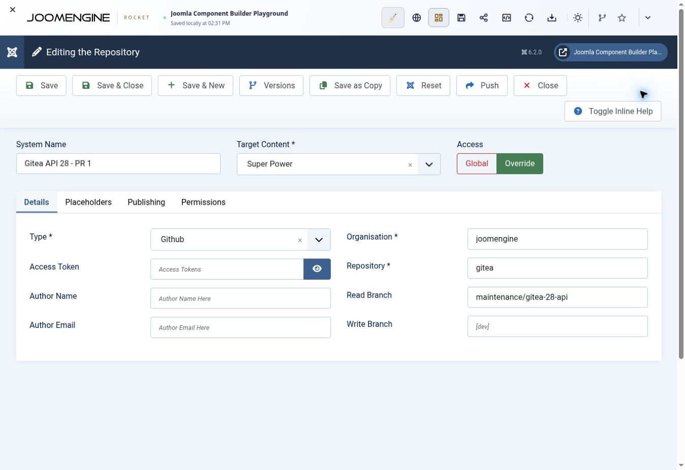

# Test a branch in the JCB playground

This procedure tests the Powers after JCB imports, compiles and installs them in
a Joomla component. The local regression suite remains a separate check; neither
one substitutes for the other.

Follow the canonical
[JCB Playground integration workflow](https://github.com/joomengine/ai-doc/blob/main/testing/playground/README.md)
for environment setup, version selection, supported diagnostics and evidence
handling. The steps below supply this branch's specific repository and consumer.

## Configure the repository

1. Open <https://playground.joomengine.org/> and start its JCB environment.
2. In Component Builder, add a published repository with target **Super Power**,
   provider type **GitHub**, owner `joomengine`, repository `gitea`, and read branch
   `maintenance/gitea-28-api`. Record the branch commit being tested. Do not
   configure a write operation.
3. Prevent another published Gitea repository from supplying the same GUIDs during
   compilation. Keep the shared foundation repositories available: this library
   depends on shared interfaces and the shared Factory.
4. Open **Powers → Pull**, select the new repository, and select its Powers. Pull
   explicitly refreshes existing GUIDs and imports missing ones from the selected
   repository. Init alone skips GUIDs that already exist locally.
5. Process manageable batches if the environment times out. Check each result and
   retry failed or incomplete batches. A partial import can leave a Power with
   metadata but missing class code; the row count alone is insufficient evidence.

The current branch has 116 indexed Powers. In particular, verify the new Client
(`6a20613d-d232-4f5b-8f86-8e41a20cd1a1`) and Operations catalog
(`b194b19f-e665-435a-925d-04158a61ef3e`) as well as the existing Http, Uri, Response,
API base and service providers. GitHub imports request metadata and class code
separately. If an actual API quota error appears, repeated smaller batches do not
resolve the quota; handle that error before retrying.

## Compile and run the demo view

1. Choose a view attached to the playground's Demo component. The current JCB 6
   seed provides **Site Views → Looks (demo-J6)**, attached to **Demo J6** with
   view code `looks`. Verify these names in the running UI before using them, and
   record the existing template before editing it.
2. In the site view's **Details → Default Tmpl** field, append the complete
   [integration template](../tests/integration/playground-template.php) after the
   existing template, or use it as the entire template of a disposable view. Its
   opening PHP tag should follow HTML or a closing PHP tag. Keep the
   `Super___GUID___Power` references; JCB uses them to include the imported classes
   and dependencies.
3. Compile **Demo J6** for Joomla 6 when using that seeded component. Confirm the
   selected Joomla target before compiling, install the resulting component, and
   open the site route `/index.php?option=com_demo&view=looks`. Use the matching
   component and view route if the running playground has different seed data.
4. Save the displayed report and the compiler/install results. Confirm the report
   has ten passing checks and zero failures, and that its class file paths belong
   to the newly compiled component rather than the classes bundled with JCB.

The template creates a fresh anonymous HTTP client and DI container. It does not
resolve JCB's configured HTTP service or use a stored token. Its only real server
requests are two read-only version requests to `https://git.vdm.dev`, one through
the new operation client and one through the existing version class. Change
`$giteaLiveBase` at the top of the template to test another public Gitea instance.

The deterministic checks verify the pinned 537-operation catalog, redirect and
authentication defaults, endpoint service construction, compiled class paths,
response decoding, path and repeated query encoding, raw file bytes, temporary
token restoration, and rejection of invalid input before transport. Their HTTP
responses come from an in-memory recording transport.

## Record the evidence

For each run, record:

- Branch and commit; JCB, Joomla and PHP versions.
- Repository read branch, imported Power count, and any failed/retried batches.
- Demo component/view name, compile target and resulting package name.
- Installation result and the view's complete pass/fail report.
- Compiled class locations and the live server's reported version.

A successful run establishes that this imported branch compiles and executes in
that consumer environment and that the version endpoint works against the
reported server. It does not establish live behavior for all 537 operations,
authenticated requests, mutations, or every supported Gitea release. Record any
transport or playground limitation separately from a library assertion failure.

This guide and template are a reproducible procedure, not a claim that a
playground run has passed. Attach the actual run evidence to the pull request.

## Attempt receipt: 2026-10-31

This attempt used the published `maintenance/gitea-28-api` branch at source commit
`34765f7ea7d65c1c3d0a76bfb2ad8f61929522aa`, with Joomla 6.2.0, JCB 6.2.0,
PHP 8.4.1 and Chrome in the browser-hosted playground.

Repository record **26**, named **Gitea API 28 - PR 1**, was configured for content
target **Super Power**, provider **GitHub**, owner `joomengine`, repository `gitea`,
and read branch `maintenance/gitea-28-api`. The bundled Codeberg mirror record
**16** was unpublished. Acquisition explicitly selected the GitHub repository;
the unpublished mirror alone is not evidence that all fallback sources were
excluded.

| Stage | Observed result |
| --- | --- |
| Branch discovery | The selected repository's catalog displayed all 116 Powers. |
| Acquisition | Partial: 82 of 116 branch Power rows were present after Init/Pull batches. The remaining 34, after Reviewers in the displayed order, were not acquired. A row count does not verify every persisted class body. |
| Persisted source | Operations, record **1324**, GUID `b194b19f-e665-435a-925d-04158a61ef3e`, was reopened in JCB. Its 199,216-character Properties & Methods body matched the branch's authoritative `code.power` after newline/outer-whitespace normalization, including `VERSION = '28.2.0'`. |
| Network diagnosis | An anonymous GitHub request in the active playground returned HTTP 403 with an API rate-limit error, limit `60` and remaining `0`. At 12:25 UTC, the reported reset time was 13:16:57 UTC. The diagnostic client IP is omitted. |
| Demo consumer | Site View **Looks (demo-J6)**, record **83**, was confirmed linked to **Demo J6**. The complete repository integration template was appended after its existing HTML and saved successfully. After closing and reopening the record, the persisted **Default Tmpl** matched the prepared combined template after newline normalization (9,455 characters), including both new Client and Operations Power references. |
| Compilation | Not run: incomplete branch acquisition blocks a valid branch compilation test. |
| Installation and runtime | Not run. No compiled package or installed-consumer result is claimed. |

The confirmed blocker is the playground's anonymous GitHub API quota. Earlier
partial batches alone did not establish whether a timeout or quota caused their
failures. Smaller batches successfully imported additional records before the
confirmed exhaustion, but do not resolve the exhausted quota. Resume supported
Pull acquisition after the limit resets, inspect the persisted branch bodies,
then compile, install and run the saved consumer before claiming integration
success.
